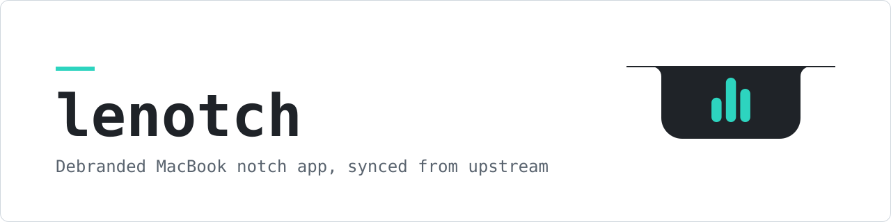

<div align="center">

<picture>
  <source media="(prefers-color-scheme: dark)" srcset="docs/assets/banner-dark.svg">
  
</picture>

# Notch

### Debranded MacBook notch app, synced from upstream

**Music, a file shelf, a timer and volume and brightness indicators in the black area
around your MacBook's camera: lephorx's lenotch without its branding.**

[](https://github.com/minomat180/lenotch/actions/workflows/fork-build.yml)
[](https://github.com/minomat180/lenotch/releases/latest)
[](#quick-start)
[](Package.swift)
[](https://github.com/lephorx/lenotch)

[Quick start](#quick-start) · [How it works](#how-it-works) · [Limits](#limits) · [Credits](#credits) · [Latest release](https://github.com/minomat180/lenotch/releases/latest)


<sub>Captured from the running app on a MacBook, with generated demo audio and demo files.</sub>

</div>

---

Notch is a fork of [lephorx/lenotch](https://github.com/lephorx/lenotch) by lephorx, who
wrote the app. This fork exists to run the app without its branding while still getting
upstream's updates: it removes the Lenotch name, logo and icon, and a script keeps it in
sync with upstream.

- **Now Playing lives in the notch.** While music plays, the closed notch shows the album
  art and moving equalizer bars; hovering or clicking opens a player with a seekable progress bar,
  play/pause and skip.
- **A shelf, a timer and indicators.** Files dropped on the notch stay there to be dragged
  out again or sent with AirDrop. Volume and brightness changes and a running timer show
  in the notch too.
- **The rebrand survives upstream updates.** `fork/debrand.sh` rewrites the tree after
  every merge: new name, its own bundle ID so it installs next to the original, an
  equalizer-bars glyph instead of the logo, and Sparkle updates from this fork. Each edit
  is followed by a check that its result is present, so a sync where an edit stops
  applying fails instead of shipping the old branding.
- **Releases follow upstream.** A daily GitHub Action merges `lephorx/lenotch`, runs the
  debrand script and pushes. When upstream tags a version, the fork tags the same version
  and builds a signed DMG and a Sparkle appcast.
- **A fix for a crash in upstream's code.** Built against the macOS 26 SDK, the
  first-launch window crashed on Get Started with "more Update Constraints in Window
  passes than there are views in the window". The fix sizes the window on the next
  run-loop turn instead of through Auto Layout
  ([`WindowPresenter.swift`](fork/overlay/Sources/Lenotch/App/WindowPresenter.swift)).

The first two are lephorx's app. The last three are what this fork adds; apart from the
name, glyph, icon and that crash fix, everything in the app is upstream's work.

## Quick start

| | Requirement |
| --- | --- |
| Run | macOS 14 or later, Apple silicon or Intel (the DMG is universal) |
| Build | Xcode 26 with Swift 6; `brew install create-dmg` for the DMG |

Download `Notch.dmg` from the
[latest release](https://github.com/minomat180/lenotch/releases/latest) and drag Notch to
Applications.

> [!IMPORTANT]
> The app is signed with a self-signed certificate and is not notarized, so macOS blocks
> the first launch. Allow it under System Settings > Privacy & Security > Open Anyway, or
> remove the quarantine flag:
>
> ```bash
> xattr -dr com.apple.quarantine /Applications/Notch.app
> ```

Later versions arrive through Sparkle: automatically if update checks are on, otherwise
through **Check for Updates…** in the menu bar icon.

To build from source:

| Command | Result |
| --- | --- |
| `SIGN_IDENTITY=- ./build.sh` | `build/Notch.app`, signed ad-hoc |
| `SIGN_IDENTITY=- ./build.sh run` | the same, then launches it |

`SIGN_IDENTITY="<certificate name>"` signs with your own certificate. Without the
variable, `build.sh` exits after signing Sparkle unless the keychain has a certificate
named "Lenotch"; CI passes the fork's self-signed certificate this way. Custom AI usage
providers are described in [docs/provider-config.md](docs/provider-config.md).

## How it works

| Path | Role |
| --- | --- |
| `fork/config.sh` | App name, bundle ID, fork and upstream repos |
| `fork/debrand.sh` | Removes the branding from the tree; safe to run repeatedly |
| `fork/overlay/` | Files copied over upstream's: glyph, icon, this README, the crash fix |
| `fork/sync-upstream.sh` | Merges upstream (upstream wins conflicts), runs `debrand.sh`, commits; `--push` also tags and starts a build |
| `.github/workflows/sync-upstream.yml` | Runs the sync daily |
| `.github/workflows/fork-build.yml` | Builds a universal DMG; on a version tag, publishes the release and appcast |

Conflicts resolve in upstream's favour and the fork's changes are re-applied by script, so
the result is upstream minus the branding, plus `fork/overlay/` and the fork's own
workflows and docs.

The crash happened because the window was sized through Auto Layout from its SwiftUI
content (`sizingOptions = .preferredContentSize`), which upstream's code still does. With
the 26 SDK, every window resize invalidated the hosting view's safe area, which asked for
another constraints pass, which resized the window again. The fork's copy measures the
content and resizes outside the constraints pass.

> [!NOTE]
> The overlay replaces whole files. That keeps the crash fix safe from upstream merges,
> but it also hides any later upstream change to `WindowPresenter.swift`, so the overlay
> copy should go once upstream fixes the crash.

## Limits

- The Windows port that upstream also ships is removed here.
- The executable inside `Notch.app` is still named `Lenotch`. Only user-facing names change.
- GitHub's built-in Actions token can't push commits that change workflow files. When an
  upstream merge touches `.github/workflows/`, the daily sync fails until
  `fork/sync-upstream.sh --push` is run from a machine with push access, or a `SYNC_TOKEN`
  secret (a token with `repo` and `workflow` scopes) is added.
- With Xcode 27, `build.sh` produces a binary that records SDK 14.0 instead of 27.2 (the
  `--build-system native` SwiftPM option records the right value). macOS uses that value
  to decide whether an app gets the macOS 26 design, so these local builds don't. CI is
  pinned to Xcode 26 for this reason.
- This is a personal fork. Feature requests and app bugs belong
  [upstream](https://github.com/lephorx/lenotch/issues).

## Credits

The app (Now Playing, shelf, calendar, weather, timer, AI usage rings, HUDs and the rest)
is [lephorx/lenotch](https://github.com/lephorx/lenotch). Now Playing uses
[mediaremote-adapter](https://github.com/ungive/mediaremote-adapter) (BSD-3-Clause,
`Vendor/MediaRemoteAdapter`).

## License

Upstream has no license file, so lephorx keeps all rights to the app's code, and this fork
does not add a license on top of it. The files in `fork/` were written for this fork.
